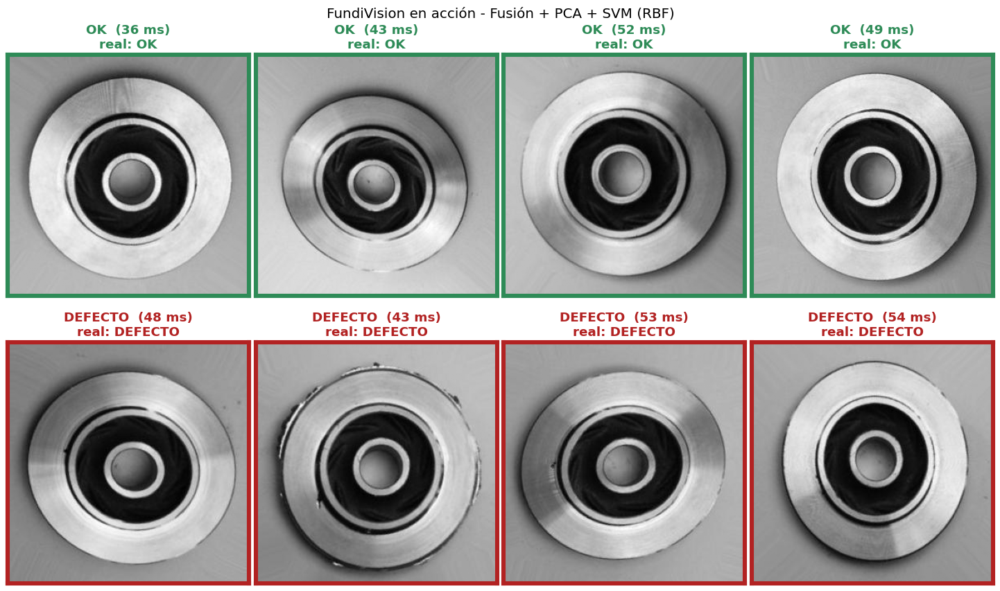
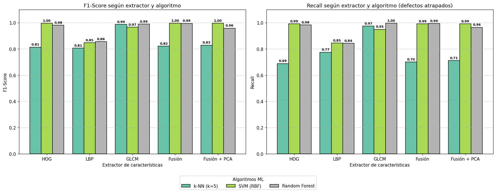

# FundiVision — Inspección visual automática de piezas fundidas

**Start-up de Visión Artificial B2B** · Entrega 3 · Visión Artificial · ITM 2026
**Integrante:** Sebastian Lopez ([@flechas122](https://github.com/flechas122))

FundiVision clasifica impulsores de bombas sumergibles como **OK** o **DEFECTO** a partir de una foto cenital. Usa solo **visión artificial clásica**, sin Deep Learning y sin GPU.



## El problema

En una fundición, cada pieza se revisa a ojo para buscar poros, rebabas o bordes incompletos. La inspección manual es lenta y cansa al operario. Además deja pasar defectos: en promedio, la industria detecta cerca del **80 %** de ellos (See, 2015, *Human Factors* 57(8)). Cuando una pieza mala llega al cliente, se puede perder el pedido completo.

## La solución (pipeline clásico)

```
Foto 300×300 (gris) → 128×128 → HOG + LBP + GLCM → fusión → Z-score → PCA (95 %) → SVM (RBF) → OK / DEFECTO
```

1. **Extracción de características:** HOG (forma y bordes, 8.100 valores), LBP uniforme (micro-textura, 10) y GLCM (textura estadística, 48), además de su fusión.
2. **Normalización Z-score** con `StandardScaler`, ajustado solo con `train`, y **reducción PCA** de 8.158 a 1.650 dimensiones.
3. **Clasificación:** k-NN, SVM y Random Forest, comparados en 15 combinaciones.

## Resultados (715 piezas de prueba nunca vistas)

| F1-Score       | k-NN  | SVM (RBF) | Random Forest |
|----------------|:-----:|:---------:|:-------------:|
| HOG            | 0,814 | 0,996     | 0,981         |
| LBP            | 0,806 | 0,846     | 0,856         |
| GLCM           | 0,987 | 0,965     | 0,989         |
| Fusión         | 0,821 | 0,996     | 0,995         |
| **Fusión + PCA** | 0,829 | **0,996** | 0,958       |

**Sistema elegido: Fusión + PCA + SVM.**

| Métrica de negocio | Valor |
|---|---|
| Exactitud global | 99,44 % |
| Defectos detectados (recall) | 99,12 % (449 de 453) |
| Piezas buenas rechazadas | 0 de 262 |
| Tiempo por pieza (1 núcleo CPU) | ~20 ms |
| Costo mensual de errores* | de ~$78,8 M a ~$3,2 M COP (−96 %) |

\* Planta de ejemplo: 2.000 piezas al día, 5 % defectuosas, $150.000 por defecto que llega al cliente y $3.000 por re-inspección. Todos los supuestos se pueden editar en el notebook.



### ¿Por qué HOG y no GLCM?

- **HOG** sabe *dónde* está el defecto: un poro o una rebaba cambia los bordes en un lugar concreto de la pieza. Logra la mejor F1 (0,996) y cero falsos rechazos.
- **GLCM** resume la textura de toda la pieza en 48 números. Es muy rápido y bueno (F1 0,989), pero al perder la ubicación aparta piezas buenas por error.
- **LBP**, con un histograma global, confunde la rugosidad normal del metal con un defecto (~82 % de exactitud).

**Limitación:** el dataset trae aumentación aplicada, así que los resultados pueden ser optimistas. El siguiente paso es un piloto con fotos nuevas de la línea de un cliente.

## Cómo ejecutarlo

1. Clone el repositorio y cree el entorno (Python 3.10):

   ```bash
   python -m venv .venv
   .venv\Scripts\activate
   pip install -r requirements.txt
   ```

2. Descargue el dataset [casting product image data for quality inspection](https://www.kaggle.com/datasets/ravirajsinh45/real-life-industrial-dataset-of-casting-product) (`archive.zip`, 105 MB) y descomprímalo en `data/`. Debe quedar `data/casting_data/casting_data/train` y `.../test`.
3. Abra el notebook y ejecute todas las celdas en orden. Tarda unos 10 minutos en CPU:

   ```bash
   jupyter notebook FundiVision_inspeccion_piezas.ipynb
   ```

## Estructura

```
FundiVision_inspeccion_piezas.ipynb   notebook principal (ejecutado, con resultados)
figuras/                              gráficas generadas por el notebook
requirements.txt                      dependencias
data/        (no se sube)             dataset de Kaggle
modelos/     (no se sube)             pipeline entrenado (joblib, ~150 MB)
```

## Dataset y licencia

Fotos de Pilot Technocast (Rajkot, India), publicadas en Kaggle por Ravirajsinh Dabhi bajo licencia **CC BY-NC-ND 4.0**. Por esa licencia, las imágenes **no** se incluyen en este repositorio. Este proyecto es académico y sin fines comerciales.
